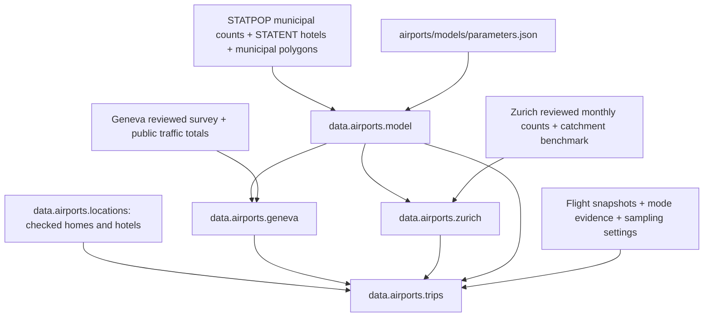

# Airport passenger demand

Start here for `data.airports`. The package turns published airport passenger
counts into municipal ODs, then into sampled passenger access trips. Geneva and
Zurich are supported. Runs use archived local evidence and do not refresh the
web automatically.

**The airport passenger totals determine demand.** The gravity model only
allocates that demand geographically. Counts include both ground directions;
do not multiply the outputs by two. These stages do not insert travellers into
synthetic households or MATSim plans.

## Stages and return values



| Stage/module | Contract | Detailed guide |
| --- | --- | --- |
| `data.airports.model` | Returns an `AirportModel` with fixed saved coefficients and current municipal features. Re-estimates only with explicit overwrite. | [Allocation and calibration](model.md) |
| `data.airports.geneva` | Returns a DataFrame of municipal passenger ODs by resident/visitor profile and direction, plus unresolved foreign regions. | [Geneva evidence and accounting](geneva.md) |
| `data.airports.zurich` | Returns a DataFrame of municipal passenger ODs by direction, plus unresolved foreign regions. No modes are assigned here. | [Zurich evidence and accounting](zurich.md) |
| `data.airports.locations` | Returns `(homes, hotels)`: two DataFrames of eligible, municipality-checked location pools, cached independently by Synpp. | [Location sampling](trips.md#residents-visitors-and-location-sampling) |
| `data.airports.trips` | Returns located Swiss-endpoint passenger trips with an `is_visitor` residence-profile tag. Foreign access is excluded; unavailable accommodation is audited separately. | [Trip schema and configuration](trips.md) |
| `geneva_times`, `zurich_times` | Importable timing/sampling helpers and explicit flight-board refresh commands; not Synpp stages. | Airport-specific timing guides above |
| `zurich_sources` | Optional PDF extraction maintenance command; not a Synpp stage. | [Zurich refresh procedure](zurich.md) |

The model depends on census/spatial inputs, not the Geneva OD stage, so its
calibration can use the survey without creating a dependency cycle. Census
counts come from `data.statpop.municipality_counts`; home sampling reuses
`data.statpop.persons`. Upstream caches are read-only.

## Observations, assumptions and missing data

| Component | Geneva | Zurich |
| --- | --- | --- |
| Passenger volume | Airport 2025 annual counts; subtract direct transit and connecting movements | Airport 2025 monthly local counts, checked against annual accounting |
| Direction | Annual arrival/departure ratio | Monthly terminal direction counts minus half of twice-counted transfers |
| Country/region | Supplied 2025 survey: Swiss cantons GE, VD, VS and other; French departments/groups and other countries | Historical 88% Swiss endpoint / 12% abroad benchmark applied to 2025 traffic |
| Municipality | Population/hotel/distance model within each observed regional constraint | Geneva model transferred over Switzerland |
| Resident/visitor | Survey outgoing vs incoming/circuit profiles | Geneva Swiss mixture transferred, conditional on municipality |
| Mode in `trips` | Swiss-endpoint shares on supplied survey p. 21 | Same Geneva shares, an explicit assumption |
| Time of day | Archived November 2026 flight counts; complete seven-day snapshot | Archived November 2026 flight counts; partial week |
| Ground travel time | Configured mode speeds × Euclidean distance × detour factor | Same method |
| Foreign ground endpoints in `trips` | Excluded | Excluded |

The private supplied Geneva PDF is visually transcribed because it has no text
layer. The archived Zurich statistics PDF supports optional `pypdf` extraction.
Ordinary pipeline runs need neither OCR nor a PDF extraction dependency.

“Swiss endpoint” means the non-airport ground endpoint is in Switzerland. It
does not mean Swiss nationality. Resident/visitor profiles describe the
traveller's journey: both profiles have movements to and from the airport.
Nationality is not inferred. In `trips`, `is_visitor=True` denotes the visitor/hotel
profile and `False` the resident/household profile; this is a modelling proxy. The
Geneva Swiss-endpoint mixture is 57.5606% residents and 42.4394% visitors, from
the reconciled 2025 survey (pp. 4–12). Zurich transfers that mixture.

The current annual-average counts, before explicit demand or sampling factors,
are 47,580.06 passenger movements/day for Geneva and 63,633.04 for Zurich.
Swiss-endpoint demand is approximately 29,975.44 movements/day for Geneva and
55,997.07 for Zurich before integer rounding. Other ground endpoints are
excluded from trip generation without increasing these Swiss totals. Visitors
without a usable hotel in their municipality remain unresolved; homes are
reserved for the resident profile. These figures describe the current input
baseline, not future calibration targets.

## Run and inspect

Keep your existing census and spatial configuration, and select:

```yaml
run:
  - data.airports.trips
config:
  # Keep the other required options from your existing pipeline configuration.
  data_path: /path/to/input/data
  random_seed: 518745
  airport_model_overwrite: false
  airport_trips_day: all
  airport_trips_sample_rate: 1.0
  airport_trips_detour_factor: 1.35
  airport_trips_missing_hotel: unresolved
```

Run `uv run -m synpp <your-config.yml>` from the repository root. Select either
airport OD stage instead if counts without sampled coordinates are sufficient.
The configured airport demand factors apply first; `airport_trips_sample_rate`
applies afterward. `input_downsampling` does not implicitly scale airport demand.

Before a first run, supply the reviewed source files and a valid
`airports/models/parameters.json`. If parameters do not exist, explicitly set
`airport_model_overwrite: true` for calibration, then return it to `false`.
Missing or invalid saved parameters cause an actionable error, never an implicit
fit. The required source inventories and override paths are in the detailed
guides. Data are not bundled in the Python package.

Inspect:

1. `airports/geneva/geneva_ods.summary.json` and
   `airports/zurich/zurich_ods.summary.json` for passenger accounting and sources.
2. `airports/models/calibration.json` for training evidence, residuals and
   transfer limitations. The returned model's `diagnostics.current_input_summary`
   describes its current census inputs; the calibration report describes fit inputs.
3. `airports/trips/summary.json` for located/unresolved counts, accommodation
   availability, resident/visitor profile shares and modes. Each airport's `timing_coverage` gives selected
   dates, missing weekdays and `complete_day_group` for each direction.
4. `airports/trips/trips.parquet` for the returned located movements, and
   `unresolved_demand.csv` for the remaining sampled counts and reasons.

For each airport, `generated_trips + unresolved_trips = sampled_trips_total`.
At sample rate 1, this equals the Swiss-endpoint source `daily_trips_integer`
total. Foreign source totals are listed only as excluded aggregates. Counts are
passengers, including drop-off passengers; occupancy and escort vehicle return
legs are not generated.

## Data folders and cache behaviour

All paths below are relative to `data_path` unless an absolute override is used:

```text
airports/
  geneva/                  supplied/reviewed survey, public archives, OD exports
    data_from_websites/    public source files, URLs/checksums, flight snapshot
  zurich/                  reviewed monthly/region tables and OD exports
    data_from_websites/    public source files, URLs/checksums, flight snapshot
  models/
    parameters.json        authoritative saved coefficients and fit provenance
    calibration.json       last explicit calibration report
    municipalities.parquet current model covariates
    model.pkl              current model object export
    signature.json
  trips/
    trips.parquet
    unresolved_demand.csv
    summary.json
    signature.json
```

There are two cache layers: Synpp caches stage results and dependencies; the
OD/trip stages also keep signed exports under `data_path`. Source/settings
changes invalidate the relevant stages. Validation checks exported files too,
so missing or modified exports cannot be hidden by an otherwise reusable Synpp
result. Stages write manifests last and verify output digests before reuse.
Home/hotel pools have their own Synpp stage cache and are reused when only trip
sampling settings change.

Changing counts, population, hotels, airport coordinates, code, or timing data
can update allocations/trips. **It never re-estimates model coefficients while
`airport_model_overwrite` is false.** Normal loading does not rewrite
`parameters.json` or `calibration.json`. Overwrite flags for Geneva and Zurich
regenerate their ODs; they do not request model calibration.

## Refresh sources deliberately

1. Follow the source and refresh URLs recorded in each airport's
   `data_from_websites/*_airport.json`. Download updated reports into that airport
   folder and retain the reporting year and retrieval date.
2. Review/extract the figures and update their metadata/checksums together.
   Geneva's image-only survey needs reviewed regional/profile tables and the
   separate page-21 mode table. A changed PDF must not retain old reviewed numbers
   merely by updating its checksum. Zurich has an explicit monthly-table helper.
3. Refresh flight snapshots only when intended, using the commands in the airport
   guides. Check complete calendar dates, operating-flight deduplication and
   named-day coverage. A new snapshot's hourly shape is still a proxy unless
   passenger loads and local/transfer splits are available.
4. Rebuild the OD/trip stages. Inspect their summaries and unresolved audit.
5. Recalibrate coefficients only if intended, using explicit overwrite. Inspect
   `calibration.json`, then switch overwrite off again.

Geneva public traffic JSON currently stores reviewed numbers and archive
identities; its archived PDFs are not automatically re-extracted or checked
against their recorded checksums at runtime. Survey and mode evidence are
checksum-checked. Zurich additionally verifies its archived sources and reviewed
input digests. This distinction matters when manually replacing a report.

## Improvements that need better evidence

| Priority | Missing evidence/work | What it would improve |
| --- | --- | --- |
| 1 | Confirm how Geneva counts connecting passengers | Resolve the remaining multiplier-one vs multiplier-two ground-demand ambiguity |
| 1 | Obtain current Zurich passenger catchment, resident/visitor and mode tables | Replace the historical country benchmark and transferred Geneva assumptions |
| 2 | Capture representative seasonal flight weeks and passenger/local-transfer weights | Improve the hourly shape and complete Zurich weekday coverage |
| 2 | Obtain hotel rooms/guest nights and visitors' accommodation types | Replace equal-establishment weights and resolve missing hotel locations |
| 2 | Route access legs or calibrate effective speeds by mode/distance | Improve travel-time and origin-departure estimates |
| 3 | Add population/plan integration, occupancy and escort logic | Produce consistent MATSim agents/vehicle legs without double-counting existing survey travel |

The current four-parameter fit is regularized and uses contemporary masses with
historical Geneva observations. Its transfer to Zurich has no local validation
or airport-competition term. Municipal detail is modelled detail, not measured
municipal OD precision. Keep those limitations with any downstream results.
