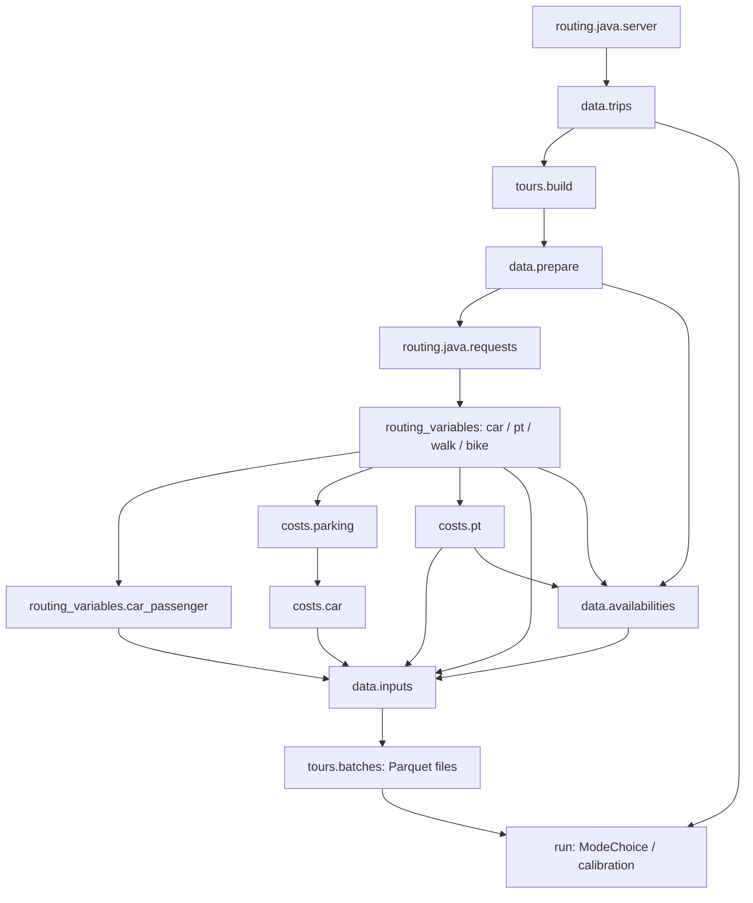

# Population mode choice

This package applies the existing `dmc.parameter_files` model to home-based tours. It does
not fit a second model. JAX and Biogeme exports use the same parameter schema.
Global mode constants **plus residence-canton offsets** enter the base utilities;
optional population calibration adjusts those constants further.

The Synpp stage `dmc.parameter_files` selects or produces the mode and cost YAML
files. `dmc.parameters` contains their shared `Parameters` container, the fitted
parameter writer and the MATSim naming conversion. Estimation stages are
`dmc.models.model_jax` and `dmc.models.model_biogeme`; their shared linear terms
live in `dmc.models.specification`.


PT quality uses the same OVGK coding in survey estimation and population choice:
`A=0`, `B=1`, `C=2`, `D=3`, and no service or missing classification `=4`.
The home feature is `homePtQuality`; the destination feature is `destinationPtQuality`.
PT utility includes
`beta_pt_home_quality * homePtQuality**gamma_pt_home_quality` plus
`beta_pt_destination_quality * destinationPtQuality**gamma_pt_destination_quality`.
Both coefficients and both exponents are estimated in JAX and Biogeme, including
when `use_exponents=False` for the existing travel-time terms. Both quality
coefficients start at `-0.05` and both exponents start at `1`. Quality exponents
are bounded to `[0.01, 2]`; powers and exponent gradients are safe at quality zero.

The writer exports `pt.betaHomePtQuality_u`, `pt.homePtQualityExponent`,
`pt.betaDestinationPtQuality_u`, and `pt.destinationPtQualityExponent`.
These replace all good/medium service coefficients. Previous fitted files need
re-estimation with this specification; there is no exact conversion from the
categorical terms. The bundled defaults use zero quality coefficients and unit
exponents until a new fit is supplied. The separate eqasim Java utility estimator
must support these new fields before the exported model can be used in MATSim;
its old good/medium implementation does not evaluate the new utility.

Renaming stages changes their Synpp cache identities. To reuse an existing fit
without estimating it again, set both `dmc_mode_parameters_path` and
`dmc_cost_parameters_path` to the existing exported files.

Use `config_dib_10.yml` as the configuration source:

```sh
uv run -m synpp config_dib_10.yml
```

Add `mode_choice.run` to its `run` list to generate population choices. Set
`enable_mode_choice: true` for MATSim and `synthesis.output` to consume those
choices. `dmc_mode_parameters_path` and `dmc_cost_parameters_path` can point to
existing fitted files; their contents are never modified.

## Follow the stages

Every stage below has its own `configure` and `execute`. Synpp caches its output
independently. The functions/classes under `model`, `selection` and the routing
client are implementation helpers, not additional data stages.

| Stage (prefix `mode_choice.`) | Output |
| --- | --- |
| `routing.java.server` | Serializable launch settings; starts Java asynchronously |
| `data.trips` | Corrected source trips as Polars, with generated `trip_id` |
| `tours.build` | `trip_id`, `tour_index`, `mode_choice_eligible` |
| `data.prepare` | Eligible trips with person, location and spatial features |
| `routing.java.requests` | Path to the shared Java request CSV |
| `routing.java.freight` | Freight/LCV requests with population person IDs |
| `routing.java.preparation` | Prepared network, facility endpoints and freight endpoints; conditional on route reuse |
| `routing.java.weights` | Trip weights and `canton_weights.parquet` diagnostics; MARouter only |
| `routing.java.road_requests` | One mixed car/freight/LCV CSV for joint assignment |
| `routing_variables.car` | `trip_id`, car time and distance |
| `routing_variables.car_passenger` | Car variables renamed for passengers; no routing call |
| `routing_variables.pt` | `trip_id`, PT time/distance components and totals |
| `routing_variables.walk` | `trip_id`, walk time and distance |
| `routing_variables.bike` | `trip_id`, bike time and distance |
| `costs.parking` | `trip_id`, parking cost and parking search time |
| `costs.car` | `trip_id`, car operating cost, parking cost and search time |
| `costs.pt` | `trip_id`, subscription-aware PT fare |
| `data.availabilities` | `trip_id`, final mode availabilities using tour minimums and trip validity |
| `data.inputs` | Strict joins of features, routing, costs and availabilities |
| `tours.batches` | List of paths to `tours_batch_num{i}.parquet` |
| `run` | Polars population trips with selected modes; diagnostic artifacts |



A generated `trip_id` is the string `person_id_trip_index`, without conversion
through floating point. The original survey `trip_id`, if present, is retained
as `source_trip_id` inside the module and restored on the final population table.
Routing/cost stage outputs contain only their trip key and produced variables.
Joins reject missing, duplicate, unknown or conflicting columns rather than
silently changing the population.

Tours are identified before routing. Only departures from `home` start a new tour;
`home_secondary` stays within the same tour. Loop modes, remote-work legs and border
chains retain their original modes. Open chains remain eligible for mode choice.
Their rows and metadata remain in `data.trips`. The later batch stage writes the
eligible tours with utilities, geometry and stable person/tour identifiers.

## Tour files and the selection class

`tours.batches` computes base utilities once, then writes compact files into its
own `context.path()`. A file contains at most `mode_choice_person_batch_size`
people, with each person's complete day kept together. Rows are trips, ordered
by person and trip index, with `tour_index` identifying their tour. Feasible mode
sequences are represented by the sampler's state graph, avoiding an exponentially
large table of enumerated alternatives.

Inspect any batch directly:

```python
import polars as pl

batch = pl.read_parquet("/path/to/stage.cache/tours_batch_num0.parquet")
print(batch.select("trip_id", "person_id", "tour_index", "utility_car", "utility_pt"))
```

The same class serves ordinary selection and every calibration evaluation:

```python
from mode_choice.selection.mode_choice import ModeChoice
from mode_choice.selection.sampler import TourSampler

with ModeChoice(batch_paths, seed=42, sampler=TourSampler(method="probability"),
                cache_prepared=True) as model:
    choices = model.run()  # Polars: trip_id, mode
    adjusted = model.run(delta=[0.2, 0.0, 0.0, 0.0, 0.0])
```

`delta` is an additive ASC adjustment in this order: car, PT, bike, walk, car
passenger. `canton="Zurich"` restricts an evaluation to that residence canton.
`draw_index=N` requests a reproducible new random draw; calibration uses zero
for stable comparisons. `last_counts` counts trips longer than 1 metre in the
same mode order, using retained numeric masks rather than repeated grouping.

Every call traverses and reads the batch files. With prepared caching enabled,
group boundaries, visit patterns, split plans and random buffers are reused;
file modification invalidates the corresponding cached preparation. Routing,
costs and base utilities are never recomputed during selection. Parquet files
are stable stage artifacts, not per-calibration-iteration output.

Normal `run` streams one prepared batch at a time. Calibration retains prepared
arrays by default; set `mode_choice_cache_prepared_batches: false` to trade some
speed for lower memory use. Retained preparation scales with the eligible
population (or the current canton), while random retention has its own bound.
The context manager and calibration cleanup release reservations on errors too.

## Routing and costs

`mode_choice_car_routing_backend` selects:

- **`java`**: `MultiModeRouterServer` routes car.
  Server times/distances are converted from seconds/metres to minutes/km.
- **`pandana`**: Pandana routes car. Optional hourly linkstats
  supply car travel times by corrected departure hour.

PT uses Java. Walk and bike are selected independently with
`mode_choice_walk_routing_backend` and `mode_choice_bike_routing_backend`:

- `java`: reuse the server and the MATSim routing configuration.
- `python` (default): compute distance as Euclidean distance × detour factor, then time
  as distance ÷ average speed, using vectorized Polars expressions.

Python defaults match `origin/eqasim-mode-choice`: walking uses
`walk_distance_factor: 1.3` and `walk_speed_m_per_s: 1.3`; cycling uses
`bike_distance_factor: 1.4` and `bike_speed_m_per_s: 4.0`. All four can be
overridden in the pipeline config. For example, Java car with Python walk/bike:

```yaml
mode_choice_car_routing_backend: java
mode_choice_walk_routing_backend: python
mode_choice_bike_routing_backend: python
```

Walk/bike do not inherit the car backend.

### Macroscopic road assignment and route reuse

The default `use_marouter_in_mode_choice: true` enables the incremental BPR road
assignment in eqasim commit `ffcd5ade6a596c0f8a586cdd9de09e06fc2e3253`.
`routing.java.road_requests` combines the eligible population's car alternatives and
all enabled `synthesis.freight.trips` / `synthesis.lcv.trips` in **one** request.
Every Java request starts with zero flows; splitting trucks into another request
would lose their congestion contribution. Freight IDs match the population writer
(`freight_<agent_id>` and `lcv_<trip_id>`, trip index zero). Cost and utility tables
retain only the passenger population's car rows.

The server receives the configured `random_seed` and `input_downsampling`, so
assignment is reproducible and capacity is scaled to the population sample once.
It uses the existing MATSim `eqasim:vdf` settings. Recorded events are used only
when MARouter is disabled. `routing.java.weights` is a separate Synpp stage,
registered only for MARouter. For each residence canton it computes:

```text
target_car_trips = eligible_trips * target_car_driver_share
driver_weight = target_car_trips / car_available_trips
```

All eligible trips count in the numerator, including minors, people without a
licence and households without cars. Only available drivers receive this weight.
Non-drivers are sent as `car_passenger` probes with weight zero: they do not add
traffic flow, but their passenger alternatives still need travel times. Car
availability also requires at least one household car. Existing mode-share
calibration still counts non-drivers and uses the full eligible population.

Freight and LCV requests receive weight 1 because they already represent vehicle
trips. Java multiplies weight by the vehicle PCU (cars 1, trucks normally 2).
Weights never include `input_downsampling`; sample size scales capacity separately.
`routing.java.weights/canton_weights.parquet` records the counts, shares and
weights. Missing targets or positive demand without any available drivers raise
an explicit error. Weights greater than one are allowed as vehicle-equivalent
assignment multipliers, with a warning that the target exceeds available trips.
Calibration reuses these weighted routes; it does not reassign roads for each ASC
iteration. This is a target-based congestion approximation before final choices.

Set `route_population_once: true` (default false) to reuse the Java itineraries:

```yaml
enable_mode_choice: true
use_marouter_in_mode_choice: true
route_population_once: true
mode_choice_car_routing_backend: java
```

`routing.java.preparation` runs Java's normal facility placement and freight relocation
before starting the server, without routing trips. It writes private prepared
network and endpoint files. `routing.java.requests` joins those facility endpoints and
uses the population writer's whole-second departure times. Requests carry
`person_id` and the original zero-based `trip_index`, including gaps left by trips
excluded from mode choice. The server then starts with `--export-routes true`.

In `matsim.simulation.prepare`, `routing.java.exports.population_routes(context)` streams
the selected modes and truck routes into `mode_choice_routes.csv` and returns its
path for `RunPopulationRouting --routes-path`. Upstream CSVs remain untouched.
The combined file omits mode choice's globally unique `trip_id`: Java matches on
`person_id` plus `trip_index`. Selected car passengers reuse the car itinerary with
the appropriate passenger mode. Walk/bike routed in Python, excluded population
trips, and incompatible or missing itineraries use Java's normal routing fallback.
Java reports reuse and fallback counts. PT components come directly from the
server in all cases, independently of route reuse.
Endpoint links that forbid a requested network mode are omitted from that mode's
request, so Java does not abort a whole batch. Missing population-mode results
receive the normal unavailable-route times; missing truck exports fall back to
population routing.

Pandana requires both `use_marouter_in_mode_choice: false` and
`route_population_once: false`. Invalid combinations fail during graph setup.

Car passengers always reuse the car route. `costs.parking` uses complete person
chains, the existing charging window and destination-specific rates/search times.
`costs.car` reads the selected simple or Weiss operating cost and includes the
parking stage's columns. The fitted utility model determines how those costs
enter each alternative.

Missing routing rows and null, NaN, infinite or negative route values are treated
as unroutable trips. Routing stages retain every requested `trip_id`, set failed
travel times to `UNROUTABLE_TIME_MIN` (1e9 minutes), and log the failure count.
Other failed-route fields use finite zero placeholders. Availability excludes
these routes explicitly, giving them utility `-inf` for both sampling methods
and during calibration. Car passengers inherit failed car routes; PT requires
valid totals and components. If a tour has no
feasible mode sequence, selection reports an error identifying the person and
tour. Duplicate or unknown routing identifiers remain errors.

The server starts with `--compute-cost true` and the configured `car_cost_model`.
`routing.java.config` creates a private copy of the PT routing config pointing to the
cost parameters from `dmc.parameter_files`, preserving relative transit/pricing input paths.
Java car and PT routing request prices together with routes, save only `trip_id` and
`car_cost_CHF` or `pt_cost_CHF` in their stage's `cost.parquet`, and return routing
variables without costs. `costs.car` and `costs.pt` read those artifacts; they do
not start Java or route again. Parking remains a separate calculation.
With Pandana, the car routing stage uses `dmc.cost.car` locally on the routed
distances and writes the same cost artifact. Simple pricing uses the fitted
`carCost_CHF_km`; Weiss pricing uses DMC's shared function. No Java pricing request
is made for Pandana car routes.
PT requests carry age, residence `home_x`/`home_y`, and the canonical
`subscriptions` strings used in population export: `none`, `GA`, `VA`, `HT`,
and `VA+HT`. Regional passes require valid residence coordinates even when the
trip starts elsewhere. Unknown subscription codes and invalid ages fail before
routing. Equivalent legacy boolean fields remain for compatibility with the
previous JAR; the updated Java server prioritizes `subscriptions`.
The current synthetic population supplies these five categories; junior and
Gleis7 passes are not separately imputed by its subscription stage.
The server's car cost excludes parking and toll charges; tolls affect routing.

The updated server automatically includes `pt_cost_data` when routing PT with
costs. This saved itinerary remains in `pt_routes.csv` and can be passed to
`RoutingServer.cost_csv(..., mode="pt")` for repricing without routing again.
The usual cost stages still read `cost.parquet`. No `savePtCostData` request or
`--save-pt-cost-data` launch option is needed with the updated API.

Java PT routing now makes one server request. The response contains total time
and distance, separate in-vehicle time/distance, access/egress walking, transfer
walking/waiting, initial waiting, transfers and optional fare/itinerary data.
`routing.java.pt` reads the numerical components directly, using minutes and km.
Initial waiting remains separate from transfer waiting, as required by DMC.
`route_population_once` controls itinerary reuse, not component availability.
There is no supplemental `RunBatchPublicTransportRouter` call in Java mode-choice
routing. Java or Python pricing remains selectable independently. Missing or
invalid components invalidate the alternative using the normal high-time sentinel.

The baseline integration was checked against commit `64b8ce08`; the canonical
subscription and automatic itinerary interfaces follow the updated sources in
`java_router/`. Rebuild and install the JAR to enable those Java changes. The server
receives `--routingDistanceUtility` from
`calibration.car_routing_vot.optimal_value`, so its calibrated result (or that
stage's default when calibration is disabled) overrides the config value. This
is a distance-disutility coefficient, not the monetary toll value of time.
The newer `tolls-value-of-time` and `tolls-sigma` options are left unset so Java
inherits their values from the supplied MATSim config. Pandana's car impedance
remains departure-hour travel time; the Java distance coefficient does not change it.

`mode_choice_car_events_path` is forwarded to the Java server. Pandana uses
`mode_choice_car_linkstats_path` instead, retaining its hourly fallback/bounding
rules. Both are optional and their file changes invalidate affected stages.

All tabular processing and stage outputs in this module use Polars. Existing
GeoPandas spatial helpers and Pandana's network constructor require conversions
at their API boundaries. MATSim and synthesis exporters convert the final Polars
population back to Pandas at their own boundary.

## Server lifecycle and logs

`routing.java.server` launches Java without waiting for initialization. Loading can
overlap subsequent Python stages once the mapped network and routing config exist;
Synpp determines the dependency order. `data.trips`, feature preparation and Java
routing ensure a live process exists even when launch settings came from Synpp's
cache. The client waits for readiness only when routing is needed.

Java binds to loopback on an automatically assigned port. Its stdout and stderr
go exclusively to `server_logs_starting_at_<UTC timestamp>.logs` under the server
stage's `context.path()`. Every actual launch creates a new file, including
restarts from cached settings. Synpp can remove older logs when rebuilding the
stage directory.

`run.execute` stops the owned server in `finally`. Client/preparation errors also
clean up, with `atexit` covering normal interpreter exit or standalone routing
runs. A forced process kill cannot run Python cleanup. Cached settings are never
treated as proof that a server is alive.

## Calibration and utility semantics

`mode_choice_calibrate_alphas` enables calibration. With level `global`, it adjusts
global ASCs against national microcensus mode shares. With level `canton`, it
adjusts additive residence-canton offsets independently against canton targets,
leaving global constants unchanged. Targets come from `data.microcensus.shares`.
PT is the fixed reference in both cases. For evaluation index `i` starting at zero:

```text
beta = min(0.8, 1 - 1 / (0.5 * i + 1))
alpha_m += (1 - beta) * (log(target_m / simulated_m)
                        - log(target_pt / simulated_pt))
```

The logarithms floor shares at `1e-6`. Convergence requires the maximum absolute
share error to meet the configured tolerance. If it does not, the best evaluated
constants and their matching choices are retained, with a warning and diagnostics.
Calibration calls `ModeChoice.run`; it does not own a second selection loop.

Final artifacts in `run`'s cache directory are `choices.parquet` (`trip_id`, `mode`)
and, when calibrating, `calibrated_parameters.yml` and `calibration.json`.
The input parameter files are unchanged. MATSim's separate model/calibration
configuration is not silently replaced by population-calibrated parameters.

The sampler supports both probability sampling and Gumbel sampling of the exact
whole-tour distribution. Car and bike positions persist across subtours and
computational splits; both must return to the original home location. Long tours
split preferentially at work, otherwise near the middle. Splitting does not
reset vehicle availability or change the seeded result. Random streams use the
seed, person ID and original tour index, making choices invariant to batching.

`data.availabilities` computes minimum motorized distance and minimum routed time
over each complete `(person_id, tour_index)` group, before computational splitting.
A short middle leg (including a zero-time snapped car route or a walking-only PT
connection) stays available in an otherwise eligible tour. Entirely short tours
and PT tours with no transit time remain unavailable for those modes. Missing,
non-finite, negative or excessively long routes are still rejected per trip;
ownership/licence constraints and the bike distance limit also remain in force.
The sampler enforces vehicle continuity, including parking a car or bike for a
subtour and collecting it at the same location afterwards.

`synthesis.population.trips_with_departures` resolves optional optimized departure
times before feature preparation and routing. Original `trips` and `activities`
stages remain unchanged. Missing corrections retain sampled departures. Arrivals
remain sampled; exporters align activity end times with the chosen trip departures.

## Main options

Model defaults and stage contracts are in `defaults.py`. The new routing flags
are declared and checked by `routing.options.configure(context)`:

```yaml
mode_choice_car_routing_backend: java
use_marouter_in_mode_choice: true
route_population_once: false
mode_choice_person_batch_size: 10000
mode_choice_sampling_method: probability  # or gumbel
mode_choice_max_trips_per_tour: 8
mode_choice_cache_prepared_batches: true  # retained between calibration evaluations
mode_choice_cache_max_entries: 1024
mode_choice_cache_max_edges: 200000
mode_choice_random_cache_max_values: 2000000  # at most 16 MB of retained draws
mode_choice_calibrate_alphas: false
mode_choice_calibration_level: global  # or canton
mode_choice_calibration_max_evaluations: 50
mode_choice_calibration_tolerance: 0.0001
mode_choice_routing_batch_size: 2048
mode_choice_server_chunk_size: 65536
```

Graph caches are bounded by entries and edges. Prepared plans retain graph keys
rather than pinning evicted transition arrays. Random streams that exceed their
retention budget are regenerated in bulk with the same seed. Cache limits affect
speed and memory, not results. Java chunks/worker batches do not bound the loaded
scenario size.

## Checks

```sh
uv run python -m pytest tests/test_mode_choice_stages.py -q
```

Tests cover stage contracts, stable large IDs, preserved source trips, both routing
backends, independent PT pricing, car-passenger reuse, cost formula equivalence,
person-batch files, both sampling methods, cache reuse/invalidation, global and
canton calibration replay, empty populations and server shutdown. Java requests
are mocked in these stage tests; they do not execute the national pipeline.

Dependency audit with the current `config_dib_10.yml`: 129 stages, 391 edges,
no cycles or conflicting configuration values. The installed Synpp 1.7.3
implementation revisits shared dependency paths during graph construction; this
graph causes about 28 million visits per pass. The standard dry run was interrupted
after several minutes. A temporary, in-process topological traversal completed the
read-only audit; the installed framework was not changed. This framework startup
bottleneck is separate from routing or mode-choice computation.


## Preparing road paths for SUMO

Set `prepare_sumo: true` with the Java car backend to save road itineraries during
normal mode-choice routing. This does not require `route_population_once` and
does not alter mode choices. SUMO's `sumo.scenario.selected` supplies only
original trips with exactly one endpoint in Switzerland to `sumo.routing.paths`, which reuses matching paths and
routes missing/changed trips, including selected external/cross-border and
commercial trips. These additional routing-only trips never enter the choice
model. `sumo.routing.network` caches corresponding directed detailed
road geometries from the exact routing network. Both stages return Arrow paths.
See [SUMO route reuse and border clipping](../sumo/population/README.md#road-route-reuse-and-swiss-border-demand-clipping)
for matching keys, timing assumptions and runtime requirements.


## Routing request timeout

`mode_choice_server_request_timeout` controls how long the Python HTTP client
waits for one CSV routing or cost request to complete. Its default is **86400
seconds (24 hours)**, allowing full-population PT and road routing to take several
hours. Override it in the pipeline configuration when needed:

```yaml
mode_choice_server_request_timeout: 86400
```

This applies to PT, car/truck routing and SUMO's missing-route completion. It is
independent of the server startup timeout and of the Slurm job time allocation.
Restart the pipeline job to load a changed timeout; a running request keeps the
value with which it started.

## Routing implementations and PT pricing

Backend-specific code lives under `mode_choice.routing.java`, `.python`, and `.flash`.
The `routing_variables` stages select implementations and return the existing trip-keyed outputs.
Common option validation and failed-route handling remain in `routing.options` and `routing.results`.

| PT routing | Default PT pricing | Optional override |
| --- | --- | --- |
| `mode_choice_pt_routing_backend: java` | Java server, together with routing | `mode_choice_pt_price_backend: python` |
| `mode_choice_pt_routing_backend: flash` | Python `dmc.cost.pt.estimate_simple_cost` | `mode_choice_pt_price_backend: java` |

The pricing option can be omitted to use the matching default. All four combinations are supported.
Python pricing uses the selected router's in-vehicle distance and the existing DMC subscription,
age and regional-pass inputs. Java routing disables per-request cost computation when Python
pricing is selected. With exported Java itineraries, PT components can still be extracted without
fare data, using boarding times embedded in the transit-route descriptions.

For FLASH with Java pricing, the shared server's `/cost` endpoint prices raw PT requests.
Java must route these internally; the resulting Java itinerary and fare can differ from FLASH.
This is a hybrid, with no promise of pure-FLASH speed or itinerary-equivalent Swiss prices.
Missing/nonfinite prices invalidate the PT alternative through the normal failed-route policy.
`costs.pt` continues reading the single `cost.parquet` owned by `routing_variables.pt`.

See [FLASH setup, limitations and benchmarks](routing/flash/README.md).

Renamed Synpp stages use new cache directories; routing/downstream stages can be rebuilt.
The fitted DMC parameter stages were not renamed by this reorganization.
