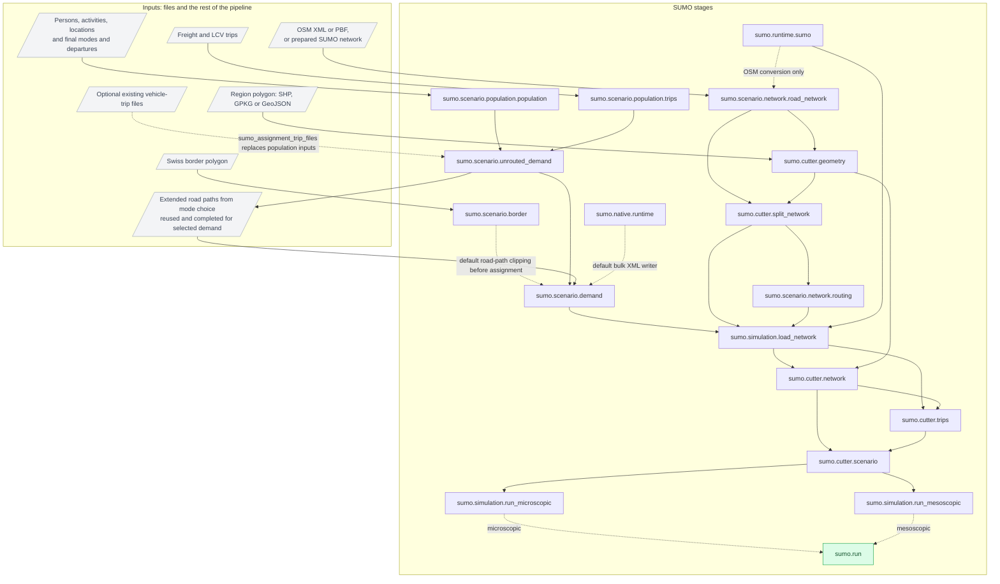
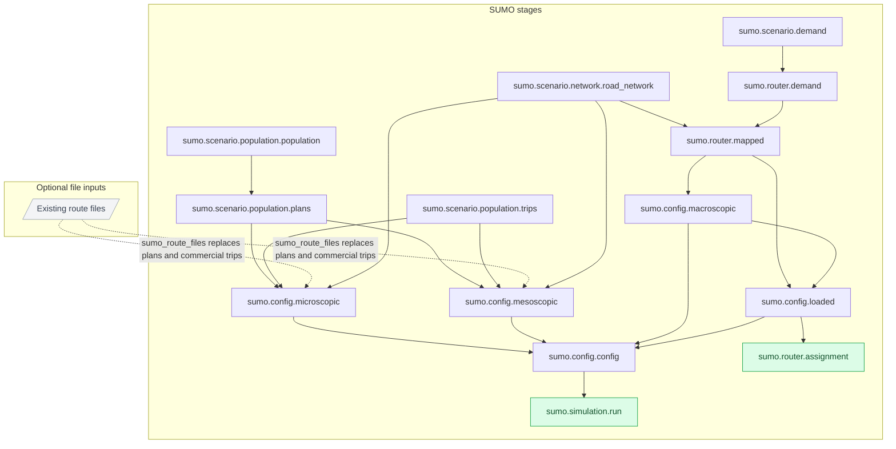

# SUMO workflow and stage structure

The `sumo/` package prepares networks and demand, loads traffic, cuts a regional
scenario, and runs microscopic or mesoscopic simulations. Synpp resolves each
stage's dependencies and caches its result. The flowcharts below show only
`sumo.*` stages; the rest of the Switzerland pipeline appears as input data.

Start with `sumo.run` for a loaded regional scenario. For setup and file-format
details, see [runtime and networks](README.md). Detailed guides cover
[population export](population/README.md), [simulation and assignment
presets](config/README.md), and [network loading and cutting](cutter/README.md).

## Regional loading, cutting and simulation

Solid arrows show results passed from a producer to a consumer. Dashed arrows
show conditional branches. Both final simulation branches are shown, but
`sumo.run` requires only the branch selected by `sumo_simulation_model`.
The diagram assumes `sumo_region_geometry` is set.



This is a data-flow overview, with repeated dependency arrows omitted for
readability. The runtime is also required by native network splitting,
network cutting and simulation. The original network remains a dependency of
loading even when loading uses its boundary-split version.

The stages perform the following steps:

1. **Prepare the full network and selected demand.**
   `road_network` detects the input format: a prepared SUMO network is returned
   directly, while OSM is converted with `netconvert`. Population tables become
   individual car trips, and commercial demand supplies truck/LCV trips.
   `sumo_modes`, defaulting to `[car, truck]`, selects exported demand; `truck`
   also includes LCV. External people are excluded by default through
   `exlude_external_population_in_sumo: true`; cross-border people remain selected
   by `include_cross_border`. Supplied vehicle-trip files bypass population preparation.
   `enable_mode_choice: true` is required. Set `prepare_sumo: true` so the normal
   mode-choice routing pass saves paths. `unrouted_demand` caches selected trips,
   then the mode-choice routing package completes only missing/changed paths on
   its extended MATSim network. Demand defaults to
   `clip_trips_to_border_in_sumo: true`: actual directed road paths determine all
   domestic visits, and retained endpoints are matched to compatible SUMO edges.
   Border entry clocks are estimated from routed total times and per-link
   free-flow proportions. See [route reuse and border timing](population/README.md#road-route-reuse-and-swiss-border-demand-clipping).
2. **Insert region boundaries before loading.**
   `geometry` transforms the polygon into the network coordinate frame.
   `split_network` splits crossing edges but retains the full inside and outside
   network. This gives loading an edge boundary at each regional entry/exit.
3. **Load and route traffic on the full network.**
   `load_network` defaults to native macroscopic `incremental` assignment;
   `SUE` is another macro option. Assigned route distributions are realized
   reproducibly as individual routes, without a subsequent `duarouter` search.
   Entry times accumulate loaded departure-slice edge costs. Full-network
   iterative routing/simulation requires explicit `sumo_loading_method: dua`.
   The stage records routes, estimated or experienced exit times, weights and metrics.
   Without a configured region, this stage uses the original unsplit network.
4. **Keep every inside visit.**
   `cutter.network` retains regional edge pieces and applies the configured
   connectivity policy. `cutter.trips` keeps the corresponding route pieces and
   sets departures to loaded entry times. A trip can cross the region with both
   endpoints outside; leaving and re-entering produces separate visits.
5. **Package and simulate the region.**
   `cutter.scenario` copies the regional network, routes and edge mapping into
   a bundle. The selected final run stage generates its own local config from
   those inputs and executes SUMO, retaining assigned paths by default
   (`sumo_rerouting_probability: 0`). `sumo.run` returns its output paths.

The final run stages reuse config-writing helpers directly. They do not depend
on the standalone `sumo.config.*` stages shown in the next diagram. The bundle
contains a microscopic config for convenience; a mesoscopic final run writes
its own mesoscopic config.

`sumo_loading_mesoscopic` controls the full-network DUA loading model.
`sumo_simulation_model` independently selects the final regional simulation.
For example, mesoscopic loading can feed a microscopic city simulation.

## Population plans, standalone configs and macroscopic assignment

This second workflow exposes person-plan export and the standalone config and
assignment stages. The four SUMO producers at the top are shared with the first
diagram. Their upstream data remain inputs; their non-SUMO dependencies are not
expanded here.



`population.plans` writes people and their activity/movement chains together in
native SUMO XML. The regional vehicle-loading workflow constructs individual
trips from the population tables instead of consuming this person-plan file.
`router.demand` is a compatibility alias for `scenario.demand`.

`router.mapped` resolves vehicle endpoints on the network. `config.macroscopic`
writes the native assignment recipe; `config.loaded` adds a routing recipe
using the resulting loaded edge weights. `router.assignment` executes both and
exports per-query metrics. Config generation itself does not execute assignment
or simulation, although mapping can run `duarouter` as an upstream dependency.

`config.config` collects **all four** config products. In the current code,
`simulation.run` depends on this bundle and executes its microscopic or
mesoscopic config according to `sumo_simulation_model`. Requesting that runner
therefore also prepares the macro/loaded config dependencies. Use `sumo.run`
for the regional cutter workflow.

The macro option inside `simulation.load_network` calls the shared assignment
and config helpers directly; it does not execute the standalone
`router.assignment` stage. The two workflows share implementation tools but
have different stage dependencies and returned results.

## Package responsibilities and stage results

| Package | Responsibility | Main results |
| --- | --- | --- |
| `sumo.runtime` | Private SUMO installation and native tool execution | Runtime paths and version |
| `sumo.scenario.network` | Format detection and OSM conversion or prepared-network reuse | Full SUMO network path |
| `sumo.scenario.population` | Polars person/activity preparation, plans and commercial trips | IPC table paths and SUMO demand XML |
| `sumo.native` | Compiled Arrow-to-XML writer | Cached C++ executable |
| `sumo.scenario.demand` | Individual vehicle queries, shared mode filtering and source metadata | Query XML and loading/query counts |
| `sumo.config` | Native XML recipes and the config bundle | Config paths; generated additional files |
| `sumo.router` | Endpoint mapping and standalone macroscopic assignment | Loaded routes, weights and trip metrics |
| `sumo.cutter` | Polygon preparation, boundary splitting and regional extraction | Regional network/routes, mappings and reports |
| `sumo.simulation` | Full-network loading and final simulation execution | Loaded full scenario or final simulation outputs |
| `sumo.run` | Select the regional execution stage | The selected run stage's result dictionary |

Modules such as `tools.py`, `modes.py`, `writer.py` and `simulation/loading.py`
provide shared functions or classes. They are not independent Synpp stages and
are intentionally absent from the graphs.

Stage results are filenames or small dictionaries; tabular results are IPC file
paths, not DataFrames. See [Polars and native XML](native/README.md). Consumers use the
producer's return value; a stage's cache directory alone does not identify its
result. The regional execution result includes `config`, `network`,
`input_routes`, `tripinfo`, `edge_data`, `summary` and simulated `routes` paths.
`simulation_report.json` records the paths in the run stage's cache.
Loading and cutting have their own reports described in the
[cutter guide](cutter/README.md).

## Run or inspect one part of the workflow

Run commands from the repository root. Use a complete local config with valid
input paths; the portable [regional run example](cutter/run.example.yml) shows
the required SUMO options.

```bash
# Run the regional simulation selected in the local SUMO configuration.
uv run -m synpp config_sumo.yml --run sumo.run

# Override the final model for this run.
uv run -m synpp config_sumo.yml --run sumo.run \
    --config sumo_simulation_model microscopic

# Stop after full-network loading or after packaging the regional scenario.
uv run -m synpp config_sumo.yml --run sumo.simulation.load_network
uv run -m synpp config_sumo.yml --run sumo.cutter.scenario

# Generate only a standalone config or export person plans.
uv run -m synpp config_sumo.yml --run sumo.config.mesoscopic
uv run -m synpp config_sumo.yml --run sumo.scenario.population.plans
```

`--run` selects the requested target, but its missing dependencies still run.
Explicitly requested targets are rerun by Synpp; valid upstream caches can be
reused. Source inputs and upstream caches remain read-only, and run outputs
stay in the consuming stage's cache.

The diagrams show the union of supported branches. The configured dependency
graph varies with input files, mode selection, optional external populations,
the region and selected model. A prepared network skips OSM conversion;
external trip/route files can skip synthesis exports; only the selected final
regional run stage is required by `sumo.run`.
