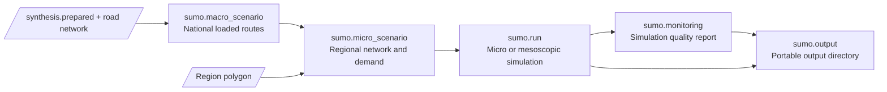
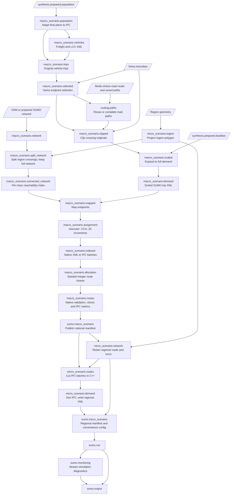

# SUMO workflow

The main entry points are deliberately short:



`micro_scenario` means the regional, detailed scenario. Both microscopic and
mesoscopic simulations use it. External pipeline stages are inputs; their
internal dependencies are not expanded in these diagrams.

## Independently cached tasks



Stage labels without the `sumo.` prefix belong to SUMO. The diagram omits
runtime/compiler dependencies and repeated input arrows. Without a region,
assignment uses the unsplit network. Explicit trip files replace the population
adapter; setting `clip_trips_to_border_in_sumo: false` skips Swiss clipping.

The prepared population already contains corrected plans and optional external,
cross-border, freight, LCV and airport demand. SUMO does not assemble those
sources again. Airport replacement plans are exported once. The independent
`exlude_external_population_in_sumo` switch still defaults to true; mode filtering
uses `sumo_modes: [car, truck]`, with truck including LCV.

Swiss clipping processes originals before expansion. Both endpoints inside:
keep; both outside: drop; one outside: use the routed border crossing. Regional
cutting instead follows the national assigned route, retaining through-trips
and separate visits after re-entry, with departures adjusted to loaded entry
times. Splitting regional crossings before assignment supplies explicit entry
edges while retaining the full national assignment network.

CCH accelerates path searches inside marouter; incremental assignment still
updates congestion costs over 20 increments. Realization uses seeded, balanced
integer allocation of marouter's route shares, with estimated edge exit clocks.
Native parsing is cached in `indexed`; `allocation` retains the established Python
random stream and writes compact selections. C++ realization stores integer edge
sequences and exit-time arrays in national IPC batches. The native cutter reads
those batches directly. XML is written after regional sorting, with ordered
parallel gzip compression. `sumo_native_routes: false` retains the Python/XML
reference path; explicit DUA loading also retains XML publication.
There is no second path search or national mesoscopic run in this default flow.
`sumo_loading_method: dua` explicitly selects simulation-based loading instead.

## Package tree

```text
sumo/
  macro_scenario/  national demand, network, assignment and realized routes
  micro_scenario/ regional geometry, network, route visits and scenario
  simulation/     run_microscopic, run_mesoscopic and execution helpers
  scenario/       shared tables, writers, metrics and demand helpers
  cutter/         shared spatial and route-cutting functions
  routing/        reuse/completion of mode-choice road paths for Swiss clipping
  native/         C++ XML writer, route clocks/cutting/filter, CCH marouter build
  config/         shared simulation/assignment configuration writers
  runtime/        private SUMO installation and executable launcher
  router/         optional standalone loaded-skims workflow
  tables.py       Polars conversion and IPC I/O
  run.py          choose microscopic or mesoscopic regional execution
  output.py       copy results into a portable export
```

Each expensive task has its own cache. For example, changing the regional writer
or route realization does not require rerunning assignment when its cache is
valid. Stage results contain paths and small manifests, not population DataFrames.
Upstream caches are read-only; portable copies are made by `sumo.output`.

## Running and migration

With a complete local configuration:

```bash
uv run -m synpp config_sumo.yml --run sumo.macro_scenario
uv run -m synpp config_sumo.yml --run sumo.micro_scenario
uv run -m synpp config_sumo.yml --run sumo.run
uv run -m synpp config_sumo.yml --run sumo.output
```

`sumo_simulation_model` selects `microscopic` (default) or `mesoscopic`.
`--run` requests a target and all missing dependencies. Do not request the
assignment stage explicitly when you only intend to reuse its valid cache.

The former `sumo.scenario.*` construction stages now live under
`sumo.macro_scenario`; `sumo.simulation.load_network` becomes
`sumo.macro_scenario`, and `sumo.cutter.scenario` becomes `sumo.micro_scenario`.
The three loading tasks are now `mapped`, `assignment`, and `routes` under
`macro_scenario`. Old regional `route_parts` and `trips` become
`micro_scenario.routes` and `micro_scenario.demand`.

Renamed stages and the prepared-source contract require new caches on the first
run. Keep Synpp `debug: false` to validate dependencies normally; old caches are
left untouched. No new national performance measurement is implied by the
small-fixture validation. See [performance](performance.md),
[population](population/README.md), [cutting](cutter/README.md) and
[configuration](config/README.md) for details.

All Python stage helpers and C++ sources live under `sumo.functions`; only stage
modules remain outside it. Every stage uses `@monitored` to request background
runtime and memory updates. See [monitoring and quality reports](monitoring.md).
