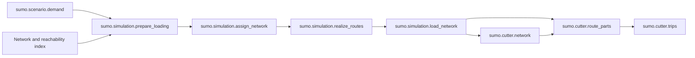

# Performance and independently cached tasks

National demand stays columnar where possible. XML remains the interface to SUMO,
and small numerical C++ kernels accelerate route arithmetic. No new Python package
or binding framework is needed: the existing Arrow writer is an executable and
route kernels use a small C ABI through `ctypes`.

## Loading stages

- `prepare_loading`: select loading trips, remap split endpoints and map roads.
- `assign_network`: run native marouter, or the optional simulation-based DUA.
- `realize_routes`: seeded route-share allocation and loaded edge clocks.
- `load_network`: restore metadata, validate and publish sorted routes and metrics.
- `route_parts`: stream national routes, reject paths without retained regional
  edges, and cut every contiguous visit into bounded Arrow parts.
- `trips`: sort retained regional parts, export XML and validate class/turn access.

The expensive assignment has its own cache. Changing realization or export code
therefore does not require another marouter run. The initial migration changes
stage identities and requires rebuilding the new stages once; old upstream
caches are not edited. Helper fingerprints propagate relevant code changes.

## Regional route cutting

Swiss clipping and regional clipping have different selection rules. Swiss
selection retains domestic endpoints directly and drops outside-to-outside trips.
Regional cutting always follows assigned routes, including trips with both
endpoints outside the region. It preserves multiple visits, boundary positions,
entry departures, partial-edge timings and directed connectivity.

`sumo_native_routes: true` (default) compiles `sumo.native.routes`, a small C++
library with independent native cutting and loaded-clock functions. Python keeps
metadata, seeded choices and final validation. Set this flag to `false` to use
reference Python arithmetic when diagnosing a difference or without a compiler.

Regional cutting reads bounded batches, shares immutable indexes between threads
and limits outstanding work. Native calls release the GIL. Metadata construction
and XML parsing still contain Python work, so allocating more threads does not
promise proportional acceleration. Regional validation occurs before publishing
the cutter result. Assignment realization still groups distributions in memory;
its peak memory is not yet bounded like regional cutting and route publication.

## Network and XML caches

`read_network(..., context=context)` stores Arrow network tables under the working
directory's `_sumo_networks/` folder. Identity includes resolved source path,
size, nanosecond modification time, reader code and cache schema. Publication is
atomic; concurrent readers do not consume incomplete caches. Each call returns
independent objects, so consumer changes cannot alter another stage's data.
Existing network files and upstream stage caches remain read-only. The binary
cache avoids repeated decompression/parsing; reconstructing Python edge objects
and geometry still has a cost.

Final route publication uses bounded Arrow parts instead of holding all national
vehicles as nested dictionaries. It sorts `(depart, id)` and keeps source metadata,
route validation and loaded timings. Source metadata and the global Polars sort
still require memory proportional to national demand.

The trip writer supports `sumo_xml_threads` (default `4`, capped by `threads` and 256).
It compresses bounded blocks into ordered gzip members. Python gzip, lxml and
SUMO can read the resulting stream. Use `1` for a conventional single-member
stream or to compare against serial output. Decompressed XML is identical.
Compression is accelerated only in the native trip writer; other XML writers
retain their buffered serial implementation.

## Launcher thread budgets

`run_sumo.sh` caps Polars to the Slurm allocation and passes that allocation as the
pipeline `threads` override. Numerical libraries retain four threads for upstream
numerical stages. Spawned border-clipping workers receive one Polars/BLAS/OpenMP
thread before imports; the parent environment is restored afterward. Java routing,
SUMO assignment, GPS rerouting and native compilation use their explicit thread
options, independently of `OMP_NUM_THREADS`.

CC/CXX and build modules remain available for compilation. Maven proxy settings
and headless execution are preserved. Increasing global BLAS/OpenMP thread counts
is not a way to accelerate SUMO movement or Polars.

## Validation

Local tests compare Python/native cuts for through-trips, re-entry, partial
endpoints, gaps and empty visits, and verify loaded-clock arithmetic. Cache tests
check reuse, source invalidation, geometry/permission preservation and input
immutability. Compression tests compare decompressed serial/parallel XML. Small
actual SUMO runs exercise assignment, regional cutting, microscopic and mesoscopic
simulation and portable export. National speedups need representative profiling;
no full national job is required to validate this implementation.

A small local arithmetic/metadata benchmark (2,000 routes of 300 edges, with 200
retained edges each) measured 1.318 seconds for the reference cutter and 0.705
seconds for the native path after conversion overhead was reduced. This excludes
XML parsing, network loading, sorting and compression; it is not a national
pipeline speedup measurement.
