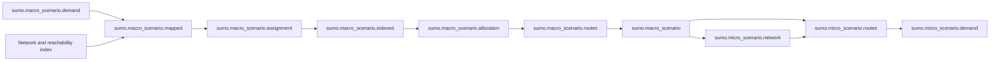

# Performance and independently cached tasks

National demand stays columnar where possible. XML is the interface to SUMO;
the default realization-to-cutter interface is structured Arrow IPC. C++ handles
SAX parsing, route permission/turn validation, loaded clocks, regional clipping
and XML serialization. The existing seeded allocation remains in Python.
No new project Python dependency or binding framework is needed. Native tools
link against the existing PyArrow libraries, system Expat and zlib.

## Loading stages

- `mapped`: filter loading trips, remap split endpoints and map roads.
- `assignment`: run CCH marouter, or the optional simulation-based DUA.
- `indexed`: parse source and assignment XML in C++ into IPC batches.
- `allocation`: index compact metadata and reproduce seeded integer route shares.
- `routes`: validate and time selected paths in native batches; write national IPC and metrics.
- `sumo.macro_scenario`: publish the national manifest, reusing validated realization files.
- Regional `routes`: scan integer edge arrays, prefilter outside paths and cut
  retained visits in C++ without Python route objects.
- Regional `demand`: sort retained IPC rows and export validated XML in buffered,
  ordered, parallel gzip blocks.

The expensive assignment has its own cache. Changing realization or export code
therefore does not require another marouter run. The initial migration changes
stage identities and requires rebuilding the new stages once; old upstream
caches are not edited. Helper fingerprints propagate relevant code changes.

## Regional route cutting

Swiss clipping and regional clipping have different selection rules. Swiss
selection retains domestic endpoints directly and drops outside-to-outside trips.
Regional cutting always follows assigned routes, including trips with both
endpoints outside the region. It preserves multiple visits, boundary positions,
entry departures, partial-edge timings and directed connectivity.

`sumo_native_routes: true` (default) builds task-specific `sumo.native.processing`
executables for indexing, realization, cutting and XML export. They share small
C++ headers; each build fingerprints only its relevant sources. Editing the
cutter does not invalidate the XML indexing build. `sumo.native.routes` retains
the small arithmetic/filter library for the legacy XML path and local checks.
Set `sumo_native_routes: false` to use the Python/XML reference workflow.
Simulation-based DUA retains its experienced-route XML workflow.

The native pipeline reads and writes sequential IPC record batches. Paths are
stored once per distribution for allocation, then realized routes use `List<Int32>`
edge indices and `List<Float64>` exit times. A separate IPC edge dictionary keeps
IDs and lengths aligned. File schema metadata references that dictionary and the
vehicle-type definitions. Python compatibility readers can still inspect these
routes through `sumo.functions.scenario.tools.iter_routes` / `read_routes`.

Assignment realization now indexes trip metadata, route distributions and vehicle
membership in a temporary disk-backed SQLite spool under its own stage directory.
It reads and writes batches of 10,000 records; no national dictionary of source
trips or list of realized vehicle objects is retained. The SQLite page cache is
limited to 128 MiB and temporary sorting uses disk. No extra dependency is needed.
Routes are stored once per distribution. Allocation uses the original seeded RNG
and first-seen group/member order. One group of member IDs is shuffled at a time
in a compact array (eight bytes per member), preserving the previous allocation
without retaining its Python vehicle objects. Very large individual groups still
need memory for that compact ID array.

Allocation follows a disk departure/ID index and exports compact ordered IPC
selections. Native realization memory-maps group paths, holds the network and
one dense loaded-cost interval, and processes batches in parallel. It does not
write a realized national XML file. Native cutting retains every inside visit;
only the regional export creates route XML. Graph and group-index metadata still
scale with the network and number of distributions, while vehicle buffers are
bounded. Uncompressed IPC favors local read speed and uses more scratch space
than compressed XML; cached parsed inputs and shared paths also occupy disk.
Temporary spools are deleted on normal completion or handled exceptions. Hard
process kills may leave temporary files in the failed stage directory. Output is
published atomically after validation and writing complete, preserving any prior
output when processing fails.

Progress logs report source and assignment indexing counts, disk index building,
allocation counts, cost-reading progress, loaded intervals, and timed/written
vehicles with percentage and elapsed time. SQLite also emits a heartbeat during
long index/allocation operations. This does not repeat marouter: its upstream
assignment cache remains independent.

### Route realization database and validation costs

The last completed CCH run (`sumo_21442803`) realized 13,983,200 vehicles in
21,821.9 seconds (6 h 4 min). Source indexing took 626.8 seconds, assignment
indexing 5,770.0 seconds, and allocation including its departure index took
3,098.8 seconds. The remaining time covered network/cost reads, validation,
timing and route output. There were 13,486,003 distribution groups, so Python
database calls per group were costly even when a group held only one vehicle.

Group insertion/lookups now operate in batches. Allocation and departure-order
export use joined database scans rather than issuing a separate Python query
for every distribution. Allocation reads compact probability vectors instead of
decoding edge sequences; single-path groups skip decoding altogether. The same
random draws are consumed so later route choices retain their seeded results.
Long edge lists are serialized once when building their
signature. Validation caches permitted edges per vehicle class, avoiding repeated
lane permission parsing for each vehicle; permission and turn checks still run.

In a local 20,000-trip fixture with 19,048 mostly unique groups and roughly
60-edge paths, indexing took 1.58 versus 0.91 seconds and allocation 0.189 versus
0.057 seconds. A separate repeated-route validation fixture took 3.15 versus
0.63 seconds. These component benchmarks exclude much of the national I/O and
are not a measured full-pipeline speedup. Permission sets add memory proportional
to the number of network edges and simulated vehicle classes. SQLite metadata
continues to use bounded batches and its existing page-cache limit.

## Network and XML caches

`read_network(..., context=context)` stores Arrow network tables under the working
directory's `_sumo_networks/` folder. Identity includes resolved source path,
size, nanosecond modification time, reader code and cache schema. Publication is
atomic; concurrent readers do not consume incomplete caches. Each call returns
independent objects, so consumer changes cannot alter another stage's data.
Existing network files and upstream stage caches remain read-only. The binary
cache avoids repeated decompression/parsing; reconstructing Python edge objects
and geometry still has a cost.

Native macro realization writes source metadata and IPC metrics while timing
and validating each route. The macro scenario references those completed files;
it no longer repeats national XML publication. Source completeness uses a compact
byte array, while the existing disk spool retains bounded metadata batches.
The optional simulation-based DUA branch still uses bounded publication parts.

The default IPC cutter tests integer edge indices before materializing candidate
routes, then processes candidates in native batches. For the XML fallback, the
immutable C++ edge filter rejects outside paths before Python tokenization.
Scenario packaging references upstream paths; portable copies belong to final
output. Standalone simulation configs supplied an IPC route file explicitly
export XML in their own cache before launching SUMO.

## Batch and I/O controls

| Option | Default | Purpose |
| --- | --- | --- |
| `sumo_route_batch_size` | `10000` | Maximum rows per processing/output batch |
| `sumo_route_batch_bytes` | `16777216` | Approximate 16 MiB payload threshold; one oversized route is allowed |
| `sumo_route_processing_threads` | `null` | Native processing workers; null uses min(`threads`, 8) |
| `sumo_xml_threads` | `4` | Ordered parallel compression, capped by allocated threads |

IPC file streams coalesce small writes in a 1 MiB buffer; XML input also uses
1 MiB buffers. Regional XML is assembled into large blocks, compressed in
parallel and written in deterministic order as standard concatenated gzip
members. Processing preserves input order inside each batch. Regional departures
are globally sorted with Polars before XML export. Row and byte thresholds
limit buffers, but the network, memory-mapped group index and a single very long
route are outside that per-batch budget. More workers can increase bandwidth
pressure; increasing them is not a guarantee of proportional speedup.

A 20,000-vehicle synthetic fixture with 60-edge paths took 4.56 seconds through
the optimized Python/XML realization path and 2.18 seconds through native
indexing, seeded allocation and IPC realization (about 2.1 times faster).
The native breakdown was 0.61 seconds parsing, 1.31 seconds allocating/exporting
selections and 0.26 seconds validating/timing/writing routes. Seeded paths,
metadata and exit times matched. This excludes native compilation and regional
cutting, and is not a measured national speedup.

## Launcher thread budgets

`run_sumo.sh` caps Polars to the Slurm allocation and passes that allocation as the
pipeline `threads` override. Numerical libraries retain four threads for upstream
numerical stages. Spawned border-clipping workers receive one Polars/BLAS/OpenMP
thread before imports; the parent environment is restored afterward. Java routing,
SUMO assignment, GPS rerouting and native compilation use their explicit thread
options, independently of `OMP_NUM_THREADS`.

CC/CXX and build modules remain available for compilation. Maven proxy settings
and headless execution are preserved. Increasing global BLAS/OpenMP thread counts
is not a way to accelerate SUMO movement or Polars.

## Validation

Local tests compare Python/native cuts for through-trips, re-entry, partial
endpoints, gaps and empty visits, and verify loaded-clock arithmetic. Cache tests
check reuse, source invalidation, geometry/permission preservation and input
immutability. Compression tests compare decompressed serial/parallel XML. Small
actual SUMO runs exercise assignment, regional cutting, microscopic and mesoscopic
simulation and portable export. National speedups need representative profiling;
no full national job is required to validate this implementation.

A small local arithmetic/metadata benchmark (2,000 routes of 300 edges, with 200
retained edges each) measured 1.318 seconds for the reference cutter and 0.705
seconds for the native path after conversion overhead was reduced. This excludes
XML parsing, network loading, sorting and compression; it is not a national
pipeline speedup measurement.
