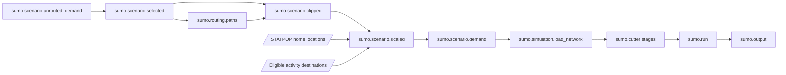

# Demand upsampling and portable exports

`sumo.scenario.scaled` expands the trips selected by `sumo_modes` to a full
sample **after original-trip Swiss-border filtering and clipping**, and before
macroscopic assignment and regional cutting. For `input_downsampling: 0.1`, it produces ten
copies in total, including the original; for `0.01`, it produces one hundred.
Keep `sumo_assignment_scale: 1` and local SUMO-GUI **Scale Traffic = 1** to avoid
expanding that demand again.



## Sampling rules

| Setting | Default | Meaning |
| --- | --- | --- |
| `input_downsampling` | Required pipeline input | Source fraction in `(0, 1]`; expansion is its reciprocal |
| `sumo_spatial_upsampling_window` | `500` metres | Maximum distance from the original endpoint to a replacement location |
| `sumo_temporal_upsampling_window` | `600` seconds | Maximum whole-chain departure shift in either direction |
| `random_seed` | Required pipeline input | Reproducible rounding, location choices and time shifts |

The original copy retains its identifier, coordinates and departures. Clones
use `sumo_scaled.<copy-number>.<original-id>` identifiers. Their source trip IDs
and source attributes remain available for tracing them back to the sample.

One replication count is chosen for each selected person's trip chain. For
example, a reciprocal sample fraction of 3.333 produces three or four copies.
The fractional extra copies are assigned to a seeded random subset of people,
with the overall person count equal to the rounded expansion target. Commercial
trips use their supplied person/tour identifier when present, otherwise their
trip identifier. Because whole chains are retained, the resulting **trip** total
need not equal the exact rounded trip-weighted target when chain lengths differ.

Each cloned chain gets one shared time shift. The configured window is symmetric:
`600` means **-600 to +600 seconds**, not a total width of 600 seconds.
Chains containing a fixed Swiss-border entry/exit anchor instead use
**+/-max(1800, 2 * sumo_temporal_upsampling_window)** seconds. Thus the default
is +/-30 minutes for border chains and +/-10 minutes for other chains. The wider
window applies to the whole chain to preserve trip order and spacing. Original
copies retain their departure times; the wider dispersion affects only clones.
`replication.arrow` records each chain's effective `time_window_s`, and
`scaling_report.json` records the border window and number of affected chains.
Negative shifts are restricted near the start of the day to keep departures
nonnegative; departures are not independently clipped, so their ordering and
spacing are preserved. No extra `random-depart-offset` is needed in SUMO.

Endpoint purposes come from the prepared population activities. Homes are
selected from unique STATPOP residential coordinates; work, education, leisure,
shop and other activities use destinations with the matching `offers_*` flag.
Sampling is uniform among eligible locations within the window, excluding the
original address (within one metre) when alternatives exist. Repeated visits to the same
location/purpose within a cloned person's chain reuse its replacement.

Commercial files usually lack activity purposes. Endpoints coinciding with a
STATPOP home (within one metre) use the home catalogue; remaining unspecified
commercial endpoints use workplaces. Foreign or sparse-area endpoints with no
eligible nearby candidate retain their original coordinates. This fallback is
counted in `scaling_report.json`; arbitrary points are not placed in water or
between buildings. A zero spatial window disables location noise. A zero time
window disables time noise for ordinary chains; border chains still use the
30-minute minimum required by the rule above.

Original endpoints are classified with vectorized polygon predicates. Trips with
both endpoints inside are retained directly, even if their possible routes could
leave and re-enter Switzerland. Trips with both endpoints outside are discarded,
including transit trips. Only trips with exactly one endpoint inside are routed
or reuse mode-choice link sequences, then clipped on that road path. Directed
link boundary intersections are indexed once in `sumo.routing.network`.

Upsampling happens after that clipping. Border entry/exit anchors remain fixed;
replacement homes and activity destinations are restricted to Switzerland.
Clones do not need another extended-MATSim-network routing pass: their modified
endpoints are mapped and routed later by SUMO's macroscopic assignment. Mode choices themselves are not
recomputed. Trips are expanded as selected vehicle demand; the original
population stages and standalone all-mode person plans remain unchanged.

## Performance and caches

The stage uses Polars, NumPy and SciPy's native spatial index. Candidate
neighbourhoods are queried once per distinct original location and purpose,
then all copies are sampled in vectors. Shared anchor arrays preserve chain
consistency. Expanded trips are written in bounded batches to uncompressed
Arrow IPC rather than accumulated as Python trip objects or Synpp pickles.
Only commercial XML metadata needs per-copy C-backed XML serialization.

The stage returns paths to `demand.arrow`, vehicle types, `replication.arrow`
and its report. It does not write intermediate trip XML. The consuming demand
stage performs the global departure sort and uses the existing native writer.
At small source fractions, expansion substantially increases the routing work
and cache volume: SUMO assignment processes full demand, while extended-network route completion
and border clipping process only the original cross-border sample. No timing speedup is promised for that larger workload.

## Regional simulation defaults

Both regional models now enable GPS rerouting for all vehicles:

- `sumo_rerouting_probability: 1`
- `sumo_rerouting_period: 60` seconds
- Observations updated every 10 seconds, averaged over six observations.
- Rerouting workers use the configured `threads` allocation.
- `sumo_time_to_teleport: 600` seconds for gridlock recovery.

Set rerouting probability to `0` to retain the assigned routes during simulation.
Set teleport time to `-1` to disable recovery. Teleporting bypasses physical
queues and can bias travel times; inspect the warnings and summary statistics.
These settings do not replace iterative assignment or traffic-light calibration.

## Export

Select `sumo.output` as the final pipeline target:

```yaml
run:
  - sumo.output
```

It consumes `sumo.run` and exports into `<output_path>/sumo/`:

- `network.net.xml.gz`: original projected regional network.
- `demand.rou.xml.gz`: full regional demand actually supplied to the simulation.
- `results/`: copies of recorded outputs, logs and the original run config.
- `<model>.sumocfg`: portable config using the projected network.
- `gui.sumocfg` and `network.gui.net.xml.gz`: portable viewing configuration
  that does not require a Swiss projection database on the local computer.
- `additional/`: additional input definitions and their referenced input files.
- `replay/`: separate outputs when locally rerunning either exported config.
- `export.json` and `HOW_TO_OPEN.txt`: export metadata and local instructions.

Open `gui.sumocfg` with SUMO-GUI 1.28.0. The GUI network keeps every Cartesian
road coordinate and connection; only geographic conversion is disabled, so
georeferenced map overlays are unavailable in that viewing copy. Server caches
and the recorded results are not modified by local playback.
