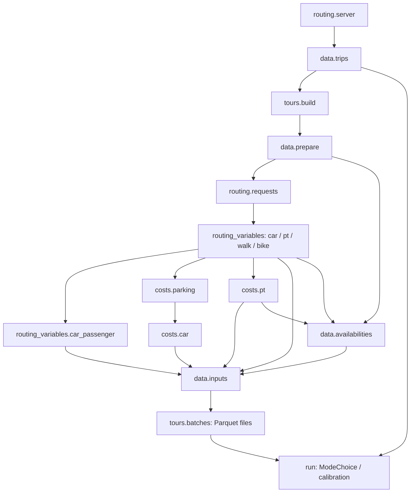

# Population mode choice

This package applies the existing `dmc.params` model to home-based tours. It does
not fit a second model. JAX and Biogeme exports use the same parameter schema.
Global mode constants **plus residence-canton offsets** enter the base utilities;
optional population calibration adjusts those constants further.

Use `config_dib_10.yml` as the configuration source:

```sh
uv run -m synpp config_dib_10.yml
```

Add `mode_choice.run` to its `run` list to generate population choices. Set
`enable_mode_choice: true` for MATSim and `synthesis.output` to consume those
choices. `dmc_mode_parameters_path` and `dmc_cost_parameters_path` can point to
existing fitted files; their contents are never modified.

## Follow the stages

Every stage below has its own `configure` and `execute`. Synpp caches its output
independently. The functions/classes under `model`, `selection` and the routing
client are implementation helpers, not additional data stages.

| Stage (prefix `mode_choice.`) | Output |
| --- | --- |
| `routing.server` | Serializable launch settings; starts Java asynchronously |
| `data.trips` | Corrected source trips as Polars, with generated `trip_id` |
| `tours.build` | `trip_id`, `tour_index`, `mode_choice_eligible` |
| `data.prepare` | Eligible trips with person, location and spatial features |
| `routing.requests` | Path to the shared Java request CSV |
| `routing_variables.car` | `trip_id`, car time and distance |
| `routing_variables.car_passenger` | Car variables renamed for passengers; no routing call |
| `routing_variables.pt` | `trip_id`, PT time/distance components and totals |
| `routing_variables.walk` | `trip_id`, walk time and distance |
| `routing_variables.bike` | `trip_id`, bike time and distance |
| `costs.parking` | `trip_id`, parking cost and parking search time |
| `costs.car` | `trip_id`, car operating cost, parking cost and search time |
| `costs.pt` | `trip_id`, subscription-aware PT fare |
| `data.availabilities` | `trip_id`, final mode availabilities using tour minimums and trip validity |
| `data.inputs` | Strict joins of features, routing, costs and availabilities |
| `tours.batches` | List of paths to `tours_batch_num{i}.parquet` |
| `run` | Polars population trips with selected modes; diagnostic artifacts |



A generated `trip_id` is the string `person_id_trip_index`, without conversion
through floating point. The original survey `trip_id`, if present, is retained
as `source_trip_id` inside the module and restored on the final population table.
Routing/cost stage outputs contain only their trip key and produced variables.
Joins reject missing, duplicate, unknown or conflicting columns rather than
silently changing the population.

Tours are identified before routing. Only departures from `home` start a new tour;
`home_secondary` stays within the same tour. Loop modes, remote-work legs and border
chains retain their original modes. Open chains remain eligible for mode choice.
Their rows and metadata remain in `data.trips`. The later batch stage writes the
eligible tours with utilities, geometry and stable person/tour identifiers.

## Tour files and the selection class

`tours.batches` computes base utilities once, then writes compact files into its
own `context.path()`. A file contains at most `mode_choice_person_batch_size`
people, with each person's complete day kept together. Rows are trips, ordered
by person and trip index, with `tour_index` identifying their tour. Feasible mode
sequences are represented by the sampler's state graph, avoiding an exponentially
large table of enumerated alternatives.

Inspect any batch directly:

```python
import polars as pl

batch = pl.read_parquet("/path/to/stage.cache/tours_batch_num0.parquet")
print(batch.select("trip_id", "person_id", "tour_index", "utility_car", "utility_pt"))
```

The same class serves ordinary selection and every calibration evaluation:

```python
from mode_choice.selection.mode_choice import ModeChoice
from mode_choice.selection.sampler import TourSampler

with ModeChoice(batch_paths, seed=42, sampler=TourSampler(method="probability"),
                cache_prepared=True) as model:
    choices = model.run()  # Polars: trip_id, mode
    adjusted = model.run(delta=[0.2, 0.0, 0.0, 0.0, 0.0])
```

`delta` is an additive ASC adjustment in this order: car, PT, bike, walk, car
passenger. `canton="Zurich"` restricts an evaluation to that residence canton.
`draw_index=N` requests a reproducible new random draw; calibration uses zero
for stable comparisons. `last_counts` counts trips longer than 1 metre in the
same mode order, using retained numeric masks rather than repeated grouping.

Every call traverses and reads the batch files. With prepared caching enabled,
group boundaries, visit patterns, split plans and random buffers are reused;
file modification invalidates the corresponding cached preparation. Routing,
costs and base utilities are never recomputed during selection. Parquet files
are stable stage artifacts, not per-calibration-iteration output.

Normal `run` streams one prepared batch at a time. Calibration retains prepared
arrays by default; set `mode_choice_cache_prepared_batches: false` to trade some
speed for lower memory use. Retained preparation scales with the eligible
population (or the current canton), while random retention has its own bound.
The context manager and calibration cleanup release reservations on errors too.

## Routing and costs

`mode_choice_car_routing_backend` selects:

- **`java`**: one `MultiModeRouterServer` routes car, PT, walk and bike. Active
  modes follow the MATSim config, including network routing or teleportation.
  Server times/distances are converted from seconds/metres to minutes/km.
- **`pandana`**: Pandana routes car; Java routes PT. Walk/bike use Euclidean
  distance, configured distance factors and speeds. Optional hourly linkstats
  supply car travel times by corrected departure hour.

Car passengers always reuse the car route. `costs.parking` uses complete person
chains, the existing charging window and destination-specific rates/search times.
`costs.car` reads the selected simple or Weiss operating cost and includes the
parking stage's columns. The fitted utility model determines how those costs
enter each alternative.

The server starts with `--compute-cost true` and the configured `car_cost_model`.
`routing.config` creates a private copy of the PT routing config pointing to the
cost parameters from `dmc.params`, preserving relative transit/pricing input paths.
Java car and PT routing request prices together with routes, save only `trip_id` and
`car_cost_CHF` or `pt_cost_CHF` in their stage's `cost.parquet`, and return routing
variables without costs. `costs.car` and `costs.pt` read those artifacts; they do
not start Java or route again. Parking remains a separate calculation.
With Pandana, the car routing stage uses `dmc.cost.car` locally on the routed
distances and writes the same cost artifact. Simple pricing uses the fitted
`carCost_CHF_km`; Weiss pricing uses DMC's shared function. No Java pricing request
is made for Pandana car routes.
PT requests carry age, home coordinates and subscription flags, so fares use
the same traveler discounts and fitted regional-subscription radius as before.
The server's car cost excludes parking and toll charges; tolls affect routing.

**Current Java API limitation:** the multimodal server supplies PT total time and
distance and fares but not the separately weighted time/distance components
required by DMC. `routing_variables.pt` therefore also calls the detailed PT router,
excluding initial waiting from transfer time. This supplemental routing remains
until the server exposes these fields. The standalone fare calculator is no longer
called. Totals are never substituted for in-vehicle times, and string trip IDs
are preserved throughout routing and pricing.

The current eqasim integration was checked against commit `64b8ce08`. The server
receives `--routingDistanceUtility` from
`calibration.car_routing_vot.optimal_value`, so its calibrated result (or that
stage's default when calibration is disabled) overrides the config value. This
is a distance-disutility coefficient, not the monetary toll value of time.
The newer `tolls-value-of-time` and `tolls-sigma` options are left unset so Java
inherits their values from the supplied MATSim config. Pandana's car impedance
remains departure-hour travel time; the Java distance coefficient does not change it.

`mode_choice_car_events_path` is forwarded to the Java server. Pandana uses
`mode_choice_car_linkstats_path` instead, retaining its hourly fallback/bounding
rules. Both are optional and their file changes invalidate affected stages.

All tabular processing and stage outputs in this module use Polars. Existing
GeoPandas spatial helpers and Pandana's network constructor require conversions
at their API boundaries. MATSim and synthesis exporters convert the final Polars
population back to Pandas at their own boundary.

## Server lifecycle and logs

`routing.server` launches Java without waiting for initialization. Loading can
overlap subsequent Python stages once the mapped network and routing config exist;
Synpp determines the dependency order. `data.trips`, feature preparation and Java
routing ensure a live process exists even when launch settings came from Synpp's
cache. The client waits for readiness only when routing is needed.

Java binds to loopback on an automatically assigned port. Its stdout and stderr
go exclusively to `server_logs_starting_at_<UTC timestamp>.logs` under the server
stage's `context.path()`. Every actual launch creates a new file, including
restarts from cached settings. Synpp can remove older logs when rebuilding the
stage directory.

`run.execute` stops the owned server in `finally`. Client/preparation errors also
clean up, with `atexit` covering normal interpreter exit or standalone routing
runs. A forced process kill cannot run Python cleanup. Cached settings are never
treated as proof that a server is alive.

## Calibration and utility semantics

`mode_choice_calibrate_alphas` enables calibration. With level `global`, it adjusts
global ASCs against national microcensus mode shares. With level `canton`, it
adjusts additive residence-canton offsets independently against canton targets,
leaving global constants unchanged. Targets come from `data.microcensus.shares`.
PT is the fixed reference in both cases. For evaluation index `i` starting at zero:

```text
beta = min(0.8, 1 - 1 / (0.5 * i + 1))
alpha_m += (1 - beta) * (log(target_m / simulated_m)
                        - log(target_pt / simulated_pt))
```

The logarithms floor shares at `1e-6`. Convergence requires the maximum absolute
share error to meet the configured tolerance. If it does not, the best evaluated
constants and their matching choices are retained, with a warning and diagnostics.
Calibration calls `ModeChoice.run`; it does not own a second selection loop.

Final artifacts in `run`'s cache directory are `choices.parquet` (`trip_id`, `mode`)
and, when calibrating, `calibrated_parameters.yml` and `calibration.json`.
The input parameter files are unchanged. MATSim's separate model/calibration
configuration is not silently replaced by population-calibrated parameters.

The sampler supports both probability sampling and Gumbel sampling of the exact
whole-tour distribution. Car and bike positions persist across subtours and
computational splits; both must return to the original home location. Long tours
split preferentially at work, otherwise near the middle. Splitting does not
reset vehicle availability or change the seeded result. Random streams use the
seed, person ID and original tour index, making choices invariant to batching.

`data.availabilities` computes minimum motorized distance and minimum routed time
over each complete `(person_id, tour_index)` group, before computational splitting.
A short middle leg (including a zero-time snapped car route or a walking-only PT
connection) stays available in an otherwise eligible tour. Entirely short tours
and PT tours with no transit time remain unavailable for those modes. Missing,
non-finite, negative or excessively long routes are still rejected per trip;
ownership/licence constraints and the bike distance limit also remain in force.
The sampler enforces vehicle continuity, including parking a car or bike for a
subtour and collecting it at the same location afterwards.

`synthesis.population.trips_with_departures` resolves optional optimized departure
times before feature preparation and routing. Original `trips` and `activities`
stages remain unchanged. Missing corrections retain sampled departures. Arrivals
remain sampled; exporters align activity end times with the chosen trip departures.

## Main options

Defaults and stage contracts are centralized in `defaults.py`:

```yaml
mode_choice_car_routing_backend: java
mode_choice_person_batch_size: 10000
mode_choice_sampling_method: probability  # or gumbel
mode_choice_max_trips_per_tour: 8
mode_choice_cache_prepared_batches: true  # retained between calibration evaluations
mode_choice_cache_max_entries: 1024
mode_choice_cache_max_edges: 200000
mode_choice_random_cache_max_values: 2000000  # at most 16 MB of retained draws
mode_choice_calibrate_alphas: false
mode_choice_calibration_level: global  # or canton
mode_choice_calibration_max_evaluations: 50
mode_choice_calibration_tolerance: 0.0001
mode_choice_routing_batch_size: 2048
mode_choice_server_chunk_size: 65536
```

Graph caches are bounded by entries and edges. Prepared plans retain graph keys
rather than pinning evicted transition arrays. Random streams that exceed their
retention budget are regenerated in bulk with the same seed. Cache limits affect
speed and memory, not results. Java chunks/worker batches do not bound the loaded
scenario size.

## Checks

```sh
uv run python -m pytest tests/test_mode_choice_stages.py -q
```

Tests cover stage contracts, stable large IDs, preserved source trips, both routing
backends, independent PT pricing, car-passenger reuse, cost formula equivalence,
person-batch files, both sampling methods, cache reuse/invalidation, global and
canton calibration replay, empty populations and server shutdown. Java requests
are mocked in these stage tests; they do not execute the national pipeline.

Dependency audit with the current `config_dib_10.yml`: 129 stages, 391 edges,
no cycles or conflicting configuration values. The installed Synpp 1.7.3
implementation revisits shared dependency paths during graph construction; this
graph causes about 28 million visits per pass. The standard dry run was interrupted
after several minutes. A temporary, in-process topological traversal completed the
read-only audit; the installed framework was not changed. This framework startup
bottleneck is separate from routing or mode-choice computation.
